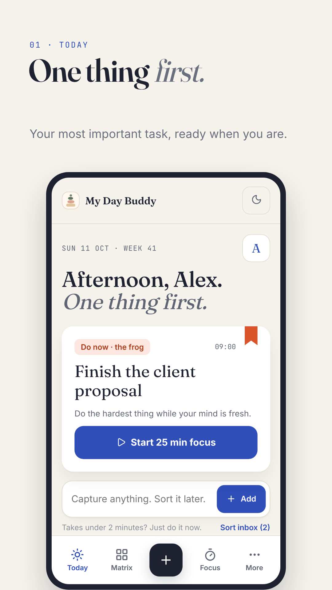
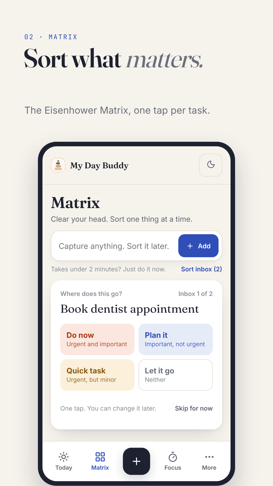
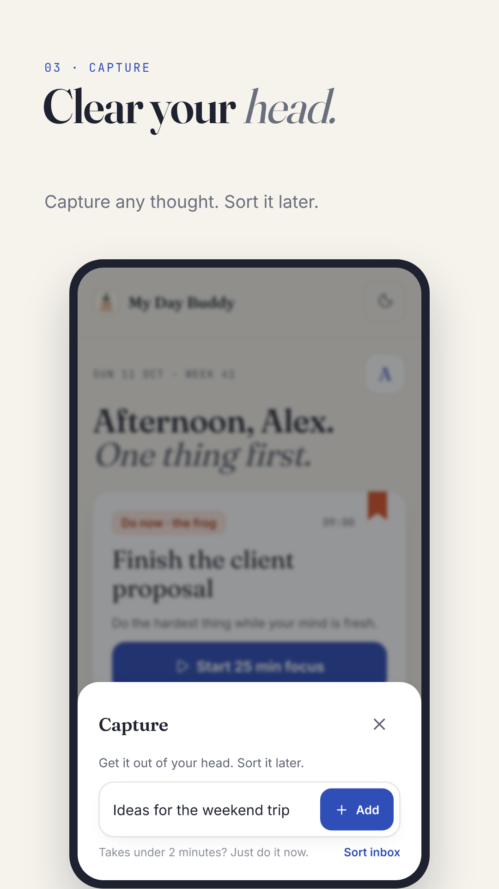
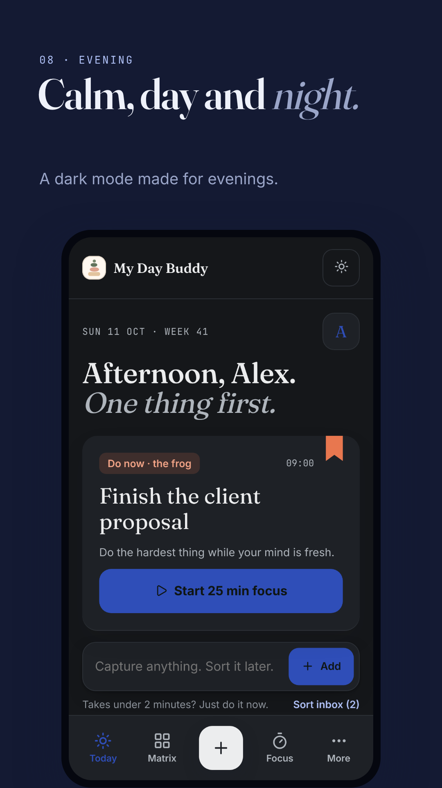

# My Day Buddy

**A calm planner built on the Eisenhower Matrix. Private, offline and free.**

<p>
  
  
  
  
</p>

[Get it on Google Play](https://play.google.com/store/apps/details?id=io.github.gauravvdev.daybook) · [Try the web version](https://gauravvdev.github.io/Daybook-app-/)

---

I built My Day Buddy because every planner I tried gave me a longer list, not a clearer head. Version 2 is a rebuild around one idea: **do the thing that matters first.**

## What it does

- **One thing first.** Each day opens on your most important task, with a single button to start focusing on it.
- **The Eisenhower Matrix, built in.** Every task gets one tap: Do now, Plan it, Quick task or Let it go. Tasks without a box are placed automatically from their priority and due date.
- **Capture in a second.** The + button drops any thought into an inbox, so it is out of your head. Sort it later.
- **Deep focus.** Pomodoro sessions and bookable focus blocks.
- **Habits that last.** A seven-day view of every habit, with forgiving "comeback" days instead of broken streaks.
- **A private journal.** Photos and voice notes, PIN or fingerprint lock, and export to a book-style file.
- **An honest weekly report.** What you finished, where your focus went, how your energy changed.

## Designed with psychology, not decoration

The look is called **Calm Focus**. Every colour has exactly one job: blue for focus and planning, vermilion only for what is urgent, green for done, amber for "come back to it". Red is never used for failure. Each screen has one primary action, and sorting a task has exactly four choices.

## Private by design

- No account, no server, no analytics, no ads.
- Everything is stored on your own device. The Android app makes **no network requests at all**: fonts and icons ship inside it.
- One-tap JSON export for backups, and one tap to delete everything.
- [Privacy policy](https://gauravvdev.github.io/Daybook-app-/privacy.html)

## How it is built

A single-file HTML, CSS and JavaScript app with no framework and no build step, wrapped for Android with Capacitor. Reminders use Android's own alarm scheduler, so they arrive with the app closed.

```
git clone https://github.com/GauravvDev/Daybook-app-.git
cd Daybook-app-
python3 -m http.server 8000
# open http://localhost:8000
```

The Android build files live in `android-build/`. The signing keystore is not in this repo and never will be.

## Licence

MIT. Icons from [Lucide](https://lucide.dev) (ISC).
